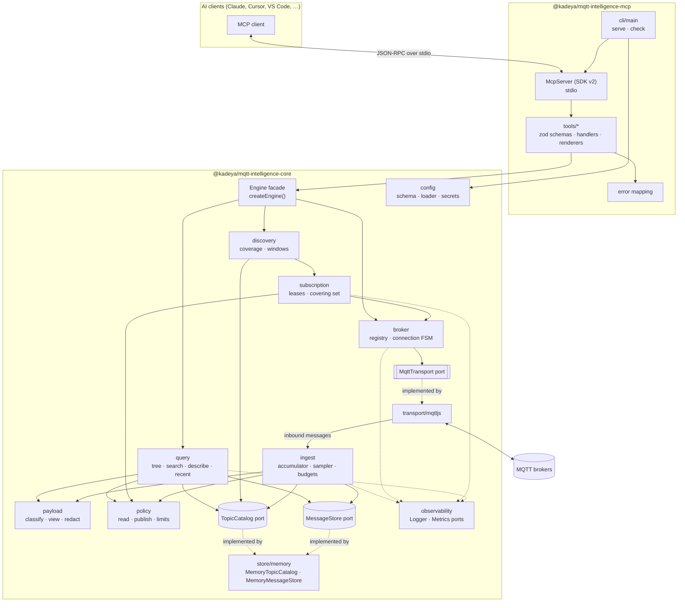
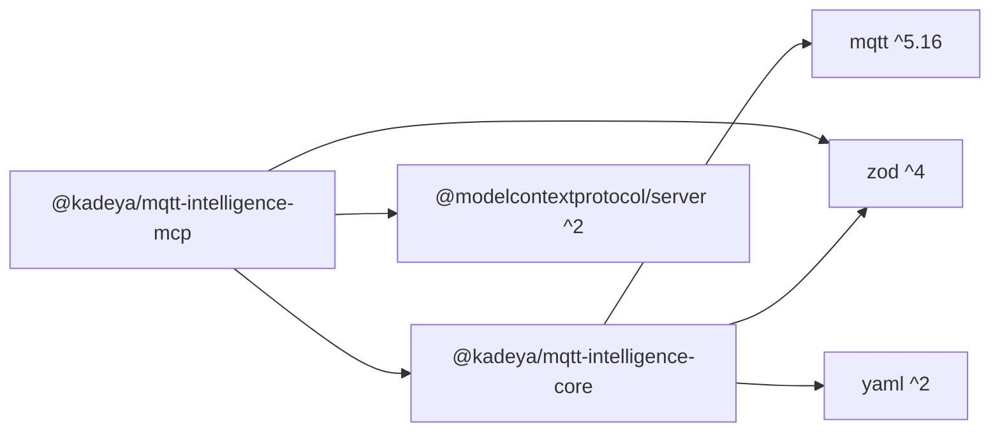
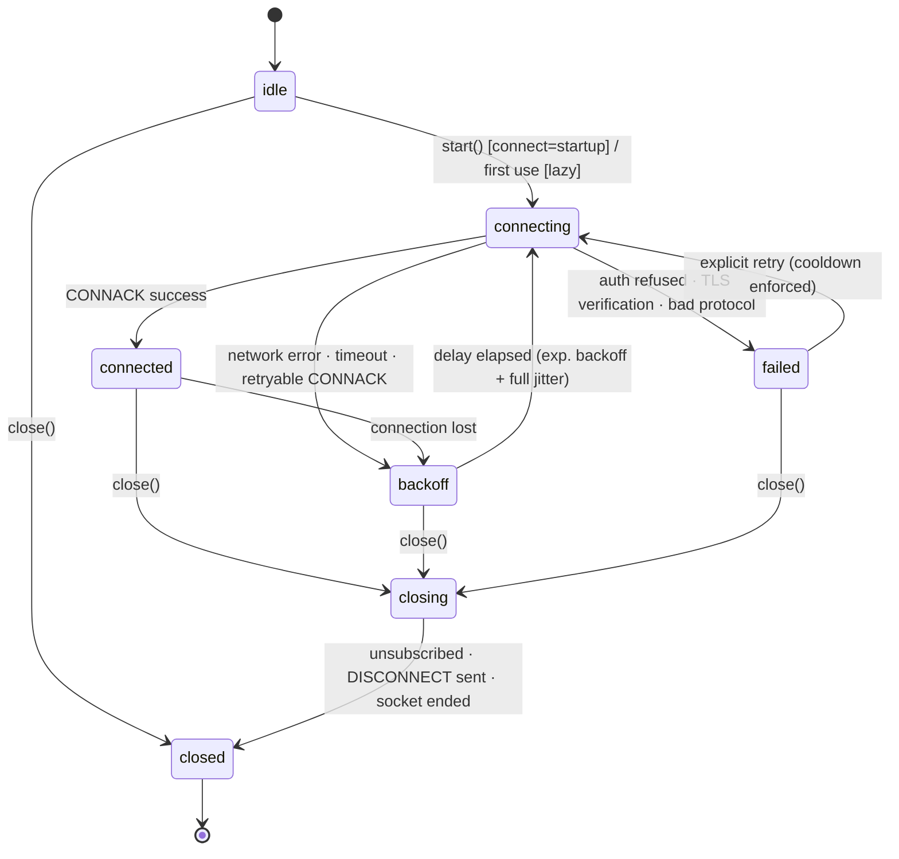
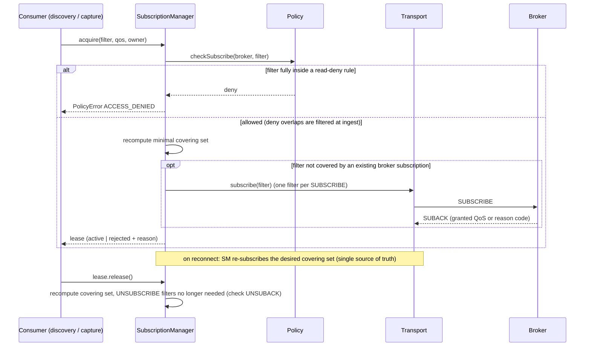
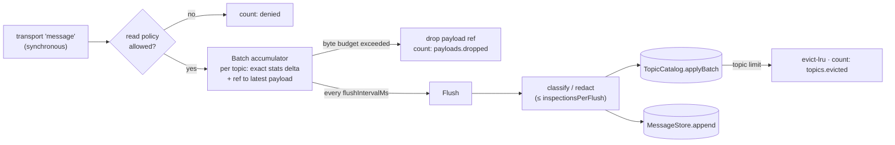
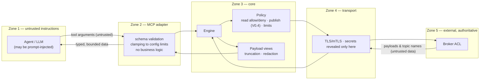

# 03 — Architecture (V0.1 target, designed for V1)

> Status: **Approved on 2026-09-18.** Decisions are recorded in the [ADRs](../adr/README.md), which prevail over this document where they differ.
> Related: [ADRs](../adr/README.md) · [Scope](04-scope-v0.1.md) · [Plan](05-implementation-plan.md)

## 1. Guiding principles

1. **The engine is a library.** MCP is one adapter among future ones (CLI, REST, embedding).
2. **Ports and adapters inside the core.** Anything with I/O or time (MQTT, storage, clock,
   logs, metrics) sits behind an interface.
3. **Count everything, inspect a sample, store a bounded window.**
4. **Every limit is explicit, configurable, and visible when hit.** Nothing is dropped silently.
5. **Security decisions happen in one place** (the policy module), never in adapters.
6. **Facts, observations and limitations are labelled.** The engine never emits inferences.
7. **Two packages until a third one is justified.**

## 2. Repository layout

```text
mqtt-intelligence-mcp/
├── packages/
│   ├── core/                      # @kadeya/mqtt-intelligence-core   (library, published)
│   │   ├── src/
│   │   │   ├── domain/            # topics, messages, ids, errors, clock, secrets (pure)
│   │   │   ├── config/            # zod schema, loader (YAML/env), secret references
│   │   │   ├── payload/           # classification, LLM-safe views, redaction
│   │   │   ├── policy/            # read/publish access policy, limits
│   │   │   ├── transport/         # MqttTransport port + mqttjs/ adapter
│   │   │   ├── broker/            # BrokerConnection (state machine), BrokerRegistry
│   │   │   ├── subscription/      # SubscriptionManager (leases, covering set)
│   │   │   ├── ingest/            # IngestPipeline (batch accumulator, sampler, budgets)
│   │   │   ├── catalog/           # TopicCatalog port, TopicRecord, mergeable stats
│   │   │   ├── store/             # MessageStore port + memory/ implementations
│   │   │   ├── discovery/         # DiscoveryService, observation coverage
│   │   │   ├── query/             # tree, search, describe, recent messages
│   │   │   ├── observability/     # Logger + Metrics ports, JSON stderr logger, no-op metrics
│   │   │   ├── testing/           # published subpath "./testing": FakeTransport, FakeClock,
│   │   │   │                      #   store contract test suite (for future adapters)
│   │   │   ├── engine.ts          # createEngine(): the public facade
│   │   │   └── index.ts           # public API (explicit exports only)
│   │   └── test/                  # unit + integration tests
│   └── mcp-server/                # @kadeya/mqtt-intelligence-mcp     (bin, published)
│       ├── src/
│       │   ├── tools/             # one file per tool: input/output schema, handler, renderer
│       │   ├── render/            # compact text renderers, answer envelope
│       │   ├── errors.ts          # core error -> MCP tool error mapping
│       │   ├── server.ts          # createMcpServer(engine, options)
│       │   └── cli/               # main (serve | check | --version), bootstrap, shutdown
│       └── test/
├── examples/
│   ├── industrial-machine/        # fictional factory simulator + docker compose + config
│   │   └── simulator/             # a third npm workspace, private and never published:
│   │                              #   one TypeScript file Node runs without compiling
│   ├── configs/                   # single broker, multi-broker, TLS/mTLS, AWS IoT, Azure EG
│   └── mcp-clients/               # Claude Desktop/Code, Cursor, VS Code configuration snippets
├── docs/
│   ├── adr/  proposal/  architecture.md  configuration.md  security.md  mcp-tools.md
│   └── discovery.md  storage.md  observability.md
├── .github/                       # workflows, issue/PR templates, dependabot, CODEOWNERS
└── LICENSE  README.md  CONTRIBUTING.md  CODE_OF_CONDUCT.md  SECURITY.md  CHANGELOG.md
```

### Why not ten packages

Internal module boundaries give the same separation without ten public APIs to keep stable
(ADR-0002). Boundaries are **enforced** by a local ESLint rule
(`tools/eslint/module-boundaries.js`, ADR-0016) that reads this table:

| Module                                         | May import                                                               |
| ---------------------------------------------- | ------------------------------------------------------------------------ |
| `domain`                                       | nothing (pure)                                                           |
| `config`, `payload`, `policy`, `observability` | `domain`                                                                 |
| `transport`                                    | `domain`, `observability` (only `transport/mqttjs` imports `mqtt`)       |
| `catalog`                                      | `domain`, `payload`                                                      |
| `store`                                        | `domain`, `payload`, `catalog` ¹                                         |
| `broker`                                       | `domain`, `policy`, `transport` (port only), `observability`             |
| `subscription`                                 | `domain`, `policy`, `transport` (port only), `broker` ², `observability` |
| `ingest`                                       | all of the above except `transport/mqttjs`                               |
| `discovery`                                    | all of the above (including `ingest`) except `transport/mqttjs`          |
| `query`                                        | `domain`, `payload`, `catalog`, `store`, `policy`                        |
| `testing`                                      | every module except `transport/mqttjs`                                   |
| `engine.ts`, `index.ts`                        | everything (composition root and public API)                             |

¹ `store/memory` implements the `TopicCatalog` port, so `store` depends on `catalog`.
² The subscription manager resubscribes on `BrokerConnection` state changes.

These two edges were added on 2026-09-18 while encoding the table as a lint rule (step 0).
`transport/mqttjs` may be imported only by the composition root (`engine.ts`, `index.ts`)
and by its own files. The rest of `transport` exposes the port.

Future packages, created only when needed: `store-sqlite` (via `node:sqlite`), `store-redis`,
`store-postgres`, `decoder-sparkplug`, `otel`, `cli`.

## 3. Component diagram



## 4. Package dependencies



Runtime dependencies are limited to these five. Everything else (arg parsing, test runner
for fakes, hashing, file loading, timers) uses Node built-ins (`node:util` `parseArgs`,
`node:crypto`, `node:fs/promises`, `AbortSignal.timeout`, `structuredClone`).

## 5. Public API of the core (library)

```ts
export function createEngine(config: EngineConfig, deps?: EngineDependencies): Engine;

export interface EngineDependencies {
  readonly clock?: Clock; // default: system clock
  readonly logger?: Logger; // default: JSON lines on stderr
  readonly metrics?: MetricsRecorder; // default: no-op
  readonly transportFactory?: TransportFactory; // default: mqtt.js
  readonly catalog?: TopicCatalog; // default: MemoryTopicCatalog
  readonly messageStore?: MessageStore; // default: MemoryMessageStore
}

export interface Engine {
  start(): Promise<void>; // connects "startup" brokers, starts discovery
  close(): Promise<void>; // graceful: unsubscribe, disconnect, flush

  listBrokers(): readonly BrokerStatus[];
  discover(
    req: DiscoverRequest,
    opts?: OperationOptions,
  ): Promise<Answer<DiscoverFacts, DiscoverObservations>>;
  topicTree(req: TopicTreeRequest): Promise<Answer<TopicTreeFacts>>;
  searchTopics(req: SearchTopicsRequest): Promise<Answer<Page<TopicSummary>>>;
  describeTopic(req: DescribeTopicRequest): Promise<Answer<TopicFacts, TopicObservations>>;
  recentMessages(req: RecentMessagesRequest): Promise<Answer<RecentMessagesFacts>>;
}

export interface OperationOptions {
  readonly signal?: AbortSignal; // cancellation (MCP cancel, Ctrl+C, timeouts)
  readonly onProgress?: (p: Progress) => void; // mapped to MCP progress notifications
}
```

The MCP adapter only ever calls `Engine`. It has no access to transports, stores or the
subscription manager.

## 6. Data model

### 6.1 Identifiers and topics

```ts
type BrokerId = string & { readonly __brand: 'BrokerId' }; // /^[a-z0-9][a-z0-9_-]{0,62}$/
type TopicName = string & { readonly __brand: 'TopicName' }; // validated concrete topic
type TopicFilter = string & { readonly __brand: 'TopicFilter' }; // validated filter (+, #)
```

`domain/topic.ts` provides pure, exhaustively tested functions:
`parseTopicName`, `parseTopicFilter`, `matches(filter, topic)`, `covers(a, b)`
(every topic matched by `b` is matched by `a`), `intersects(a, b)`, `levels(topic)`.
All MQTT rules apply: UTF-8, ≤ 65,535 bytes, no U+0000, `#` last and alone in its level,
`+` alone in its level, `$`-prefixed topics not matched by leading wildcards.

### 6.2 Observed message

```ts
interface ObservedMessage {
  readonly brokerId: BrokerId;
  readonly topic: TopicName;
  readonly receivedAt: number; // epoch ms, wall clock at receipt (NOT publish time)
  readonly sequence: number; // monotonic per broker, process lifetime; orders same-ms events
  readonly deliveredQos: 0 | 1 | 2; // = min(publisher QoS, subscription QoS)
  readonly retainFlag: boolean; // as delivered
  readonly retainedReplay: boolean; // delivered from the broker's retained store at subscribe time
  readonly payload: StoredPayload;
  readonly properties?: Mqtt5Properties;
}

interface StoredPayload {
  readonly size: number; // original size in bytes
  readonly bytes: Uint8Array; // copied, truncated to limits.maxStoredPayloadBytes
  readonly truncated: boolean;
  readonly classification: PayloadClassification;
}

interface Mqtt5Properties {
  readonly contentType?: string;
  readonly payloadFormatIndicator?: 0 | 1;
  readonly messageExpiryInterval?: number;
  readonly responseTopic?: string;
  readonly correlationDataSize?: number; // size only, never the bytes
  readonly userProperties?: ReadonlyArray<readonly [string, string]>; // bounded count/length
}
```

### 6.3 Payload classification and LLM-safe views

```ts
type PayloadKind = 'empty' | 'json' | 'number' | 'boolean' | 'text' | 'binary' | 'unknown';

interface PayloadClassification {
  readonly kind: PayloadKind;
  readonly jsonType?: 'object' | 'array' | 'string' | 'number' | 'boolean' | 'null';
  readonly reason?: 'oversized' | 'not-inspected' | 'budget-exhausted'; // only for 'unknown'
}
```

Deterministic classification order: size 0 → `empty`; size > `maxInspectBytes` → `unknown`
(`oversized`); invalid UTF-8 or control-character ratio above threshold → `binary`;
`true`/`false` → `boolean`; finite numeric literal → `number`; `JSON.parse` succeeds on a
value starting with `{`, `[` or `"` → `json`; otherwise `text`. MQTT 5 `contentType` and
`payloadFormatIndicator` are recorded as facts, never trusted over the bytes.

```ts
type PayloadView =
  | { kind: 'empty' }
  | { kind: 'json'; value: JsonValue; truncated: boolean; redactedKeys: number }
  | { kind: 'number'; value: number }
  | { kind: 'boolean'; value: boolean }
  | { kind: 'text'; text: string; truncated: boolean } // control chars escaped
  | { kind: 'binary'; size: number; sha256: string; hexPreview: string } // first 32 bytes
  | { kind: 'unknown'; size: number; reason: string };
```

JSON views are depth-, key- and string-length-limited and pass through redaction
(`security.redaction.jsonKeys`). Binary is **never** base64-dumped.

### 6.4 Topic record (catalog entry)

```ts
interface TopicRecord {
  readonly brokerId: BrokerId;
  readonly topic: TopicName;
  readonly firstSeenAt: number;
  readonly lastSeenAt: number;
  readonly lastLiveAt?: number; // excludes retained replays
  readonly messageCount: number; // all deliveries
  readonly retainedReplayCount: number;
  readonly bytesTotal: number;
  readonly maxPayloadSize: number;
  readonly qosCounts: readonly [number, number, number];
  readonly retainedState: 'present' | 'cleared' | 'unknown';
  readonly payloadKinds: Readonly<Partial<Record<PayloadKind, number>>>; // over inspected samples
  readonly inspectedCount: number;
  readonly rate: EwmaState; // live messages only
  readonly interArrival: WelfordState; // live messages only: n, mean, m2, min, max
}
```

All statistics are **mergeable** (additive counters, min/max, Welford/Chan merge, EWMA
advanced by batch) so that several ingest workers or a database-side aggregation can
produce the same record (scale-out path, ADR-0009).

### 6.5 Answer envelope (FACT / OBSERVATION / LIMITATION)

```ts
interface Answer<TFacts, TObservations = never> {
  readonly facts: TFacts; // observed directly: counts, timestamps, payloads
  readonly observations?: TObservations; // computed deterministically from facts; each field documented
  readonly coverage: ObservationCoverage; // what we were able to see
  readonly limitations: readonly Limitation[];
}

interface ObservationCoverage {
  readonly brokerId: BrokerId;
  readonly filters: readonly TopicFilter[]; // active discovery subscriptions
  readonly rejectedFilters: readonly { filter: TopicFilter; reason: string }[];
  readonly observingSince?: number;
  readonly connectedMs: number;
  readonly gaps: readonly { from: number; to: number; reason: 'disconnected' | 'not-started' }[]; // bounded
  readonly droppedPayloads: number;
  readonly evictedTopics: number;
}

interface Limitation {
  readonly code:
    | 'SHORT_OBSERVATION_WINDOW'
    | 'DISCONNECTED_DURING_WINDOW'
    | 'FILTER_REJECTED'
    | 'DELIVERED_QOS_ONLY'
    | 'RETAINED_REPLAY_TIME_UNKNOWN'
    | 'PAYLOADS_DROPPED'
    | 'TOPICS_EVICTED'
    | 'SAMPLED'
    | 'TRUNCATED'
    | 'READ_POLICY_FILTERED';
  readonly message: string;
}
```

The core never produces an `inference` section. That is the agent's job.

## 7. Configuration

Loaded from YAML (`--config`, or `MQTT_INTELLIGENCE_CONFIG`), validated by a zod schema,
then frozen. A file-less quick start is supported:
`MQTT_URL=mqtt://localhost:1883 npx @kadeya/mqtt-intelligence-mcp`.

```yaml
version: 1

brokers:
  factory-fr:
    url: mqtts://mqtt-fr.example.com:8883 # credentials in the URL are rejected
    protocolVersion: 5 # 5 | 4 (3.1.1)
    clientId:
      prefix: mqtt-observer # default; random suffix appended
    connect: startup # startup | lazy
    auth:
      username: { env: MQTT_FR_USERNAME } # or a plain string (usernames are not secret)
      password: { env: MQTT_FR_PASSWORD } # { env } | { file } — plain strings are rejected
    tls:
      ca: { file: ./certs/ca.pem }
      cert: { file: ./certs/client.pem } # cert + key => mTLS
      key: { file: ./certs/client.key }
      keyPassphrase: { env: MQTT_FR_KEY_PASSPHRASE }
      serverName: mqtt-fr.example.com
      alpn: [] # e.g. [x-amzn-mqtt-ca] for AWS IoT on 443
      rejectUnauthorized: true # false => warning + reported as "insecure"
    timeouts:
      connectMs: 10000
      keepaliveSeconds: 30
    reconnect:
      initialDelayMs: 1000
      maxDelayMs: 60000
    discovery:
      enabled: true
      filters: ['#']
      includeSysTopics: false
      subscriptionQos: 0
    security: # merged with global; deny lists are unioned
      read:
        deny: ['+/secrets/#']

security:
  read:
    allow: ['#']
    deny: []
  redaction:
    jsonKeys: [password, passwd, secret, token, apikey, api_key, authorization, privatekey]
  publish:
    enabled: false # the publish tool does not exist in V0.1

limits:
  maxTopicsPerBroker: 50000
  onTopicLimit: evict-lru # evict-lru | ignore-new
  maxInspectBytes: 262144
  maxStoredPayloadBytes: 8192
  recentMessagesPerTopic: 20
  messageStoreMaxBytes: 134217728
  pendingPayloadMaxBytes: 67108864
  flushIntervalMs: 100
  inspectionsPerFlush: 2000

mcp:
  maxResultItems: 200
  maxPayloadPreviewChars: 2000
  discoverMaxWaitSeconds: 30

storage:
  type: memory

logging:
  level: info # trace | debug | info | warn | error
  format: json # json | pretty
```

Rules:

- **Secrets** are `SecretRef = { env: string } | { file: string }`, resolved once at start
  into a `Secret` object whose `toString()`, `toJSON()` and `util.inspect` return
  `[REDACTED]`. Only `transport/mqttjs` calls `secret.reveal()`.
- Relative file paths are resolved from the config file's directory.
- Unknown keys are **errors** (typos in security config must never be silently ignored).
- `version` enables future migrations.
- Error messages point to the exact path: `brokers.factory-fr.auth.password: plain-text
secrets are not allowed; use { env: "…" } or { file: "…" }`.

## 8. Error model

```ts
abstract class MqttIntelligenceError extends Error {
  abstract readonly code: ErrorCode;
  readonly retryable: boolean;
  readonly details: Readonly<Record<string, string | number | boolean>>; // safe to expose
}
```

| Class             | Codes                                                                                                                                                       |
| ----------------- | ----------------------------------------------------------------------------------------------------------------------------------------------------------- |
| `ConfigError`     | `CONFIG_INVALID`, `CONFIG_SECRET_UNRESOLVED`                                                                                                                |
| `BrokerError`     | `BROKER_NOT_FOUND`, `BROKER_AMBIGUOUS`, `BROKER_UNAVAILABLE`, `BROKER_AUTH_FAILED`, `BROKER_TLS_ERROR`, `BROKER_CONNECTION_FAILED`, `SUBSCRIPTION_REJECTED` |
| `PolicyError`     | `ACCESS_DENIED`, `LIMIT_EXCEEDED`                                                                                                                           |
| `ValidationError` | `INVALID_TOPIC`, `INVALID_ARGUMENT`                                                                                                                         |
| `NotFoundError`   | `TOPIC_NOT_OBSERVED`                                                                                                                                        |
| `OperationError`  | `TIMEOUT`, `CANCELLED`                                                                                                                                      |
| `InternalError`   | `INTERNAL` (details logged with a correlation id, never returned)                                                                                           |

- Errors from mqtt.js / Node are wrapped, **sanitized** (URLs stripped of userinfo, secrets
  masked) and kept as `cause` for logs only.
- MCP mapping: domain errors become tool results with `isError: true` and a text of the
  form `ACCESS_DENIED: … Hint: …` so the agent can self-correct. Only malformed protocol
  requests become protocol errors.
- Error codes are part of the public API (semver-governed).

## 9. Broker lifecycle



- mqtt.js is used with `reconnectPeriod: 0`, `resubscribe: false`, `clean: true`
  (MQTT 5: `sessionExpiryInterval: 0`) and an explicit `connectTimeout`; a hard timeout
  wraps each attempt.
- **Authentication failures are never retried automatically** (brokers may lock accounts
  after repeated failures). `failed` exits only through an explicit retry.
- Each state transition emits an event (`BrokerStatus` change), a log line and metrics;
  connected periods feed `ObservationCoverage.gaps`.
- Default client ID: `mqtt-observer-<8 random hex>`; a fixed client ID is allowed but logged
  with a warning (collision risk with real devices).

## 10. Subscription lifecycle

Consumers never subscribe directly; they acquire **leases**.

```ts
interface SubscriptionManager {
  acquire(brokerId: BrokerId, request: LeaseRequest): Promise<SubscriptionLease>;
}
interface LeaseRequest {
  readonly filter: TopicFilter;
  readonly qos: 0 | 1 | 2;
  readonly owner: string;
}
interface SubscriptionLease {
  readonly id: string;
  readonly state: 'pending' | 'active' | 'rejected';
  readonly rejection?: { reasonCode: number; reason: string };
  release(): Promise<void>;
}
```



- Broker-side subscriptions = **minimal covering set** of active lease filters; inbound
  messages are matched locally and fanned out, so each delivery is counted **once** even
  with overlapping consumers.
- When a broader filter replaces narrower ones, the broader one is subscribed first, then
  the narrower ones are unsubscribed. During that short window a broker may deliver a
  message twice; this is accepted, documented, and covered by an integration test that
  bounds its effect.
- A consumer joining under an existing covering subscription does not receive a new
  retained replay; the catalog's last-known messages provide that snapshot.

## 11. Ingest pipeline and backpressure



- The transport handler is **synchronous and O(1)**: policy check, stats delta update,
  keep a reference to the latest payload of that topic. No awaiting, no parsing → PINGRESP
  and keepalive are never starved (mqtt.js issue #1935).
- Every `flushIntervalMs` (default 100 ms) the accumulator is swapped and flushed:
  one _copied, truncated_ payload per topic per flush is classified and appended to the
  message store; stats deltas are merged into the catalog.
- Consequences, stated as facts to the agent: _message counts are exact; the last message
  is exact; recent-message history is sampled at ≤ 1 message per topic per flush interval._
- Memory is bounded by: `maxTopicsPerBroker × O(1) stats` + `pendingPayloadMaxBytes` +
  `messageStoreMaxBytes`. A `#` subscription on a large broker cannot exhaust memory.
- MQTT 5 connections advertise `maximumPacketSize` so the broker does not send packets we
  would discard anyway.

## 12. Storage abstraction

```ts
interface TopicCatalog {
  applyBatch(brokerId: BrokerId, deltas: readonly TopicDelta[]): Promise<CatalogBatchResult>;
  get(brokerId: BrokerId, topic: TopicName): Promise<TopicRecord | undefined>;
  query(query: TopicQuery): Promise<Page<TopicRecord>>; // filter, text, sort, cursor
  tree(query: TreeQuery): Promise<TopicTreeNode>; // aggregated hierarchy
  stats(brokerId: BrokerId): Promise<CatalogStats>;
}

interface MessageStore {
  append(batch: readonly ObservedMessage[]): Promise<void>;
  recent(brokerId: BrokerId, topic: TopicName, limit: number): Promise<readonly ObservedMessage[]>;
  query(query: MessageQuery): Promise<Page<ObservedMessage>>; // broker, filter, time range, cursor
  stats(): Promise<MessageStoreStats>;
}
```

- Two ports because the access patterns differ (aggregated hot updates vs. append-only log).
- Batch-oriented writes; cursor-based pagination everywhere (no offset scans).
- V0.1 implementations: `MemoryTopicCatalog` (Map + LRU), `MemoryMessageStore`
  (per-topic ring buffers + global byte budget, oldest-first eviction).
- A **reusable contract test suite** (`@kadeya/mqtt-intelligence-core/testing`) is the
  acceptance test for every future adapter (SQLite, Redis, Postgres/Timescale).

## 13. Security boundaries



| Boundary              | Guarantee                                                                                                                                                                                   |
| --------------------- | ------------------------------------------------------------------------------------------------------------------------------------------------------------------------------------------- |
| Agent → adapter       | Arguments validated by zod; numeric limits clamped to configuration; no regex from the agent; unknown brokers rejected.                                                                     |
| Adapter → core        | The adapter can only call `Engine`. It cannot reach transports, stores or subscriptions.                                                                                                    |
| Core policy           | Single decision point. Deny beats allow. Read-denied topics are dropped at ingest (never stored, never listed). Publish does not exist in V0.1.                                             |
| Core → transport      | Secrets are opaque `Secret` objects; revealed only when building mqtt.js options.                                                                                                           |
| Broker → core → agent | Payloads and topic names are untrusted: always typed, truncated, escaped, redacted; binary never dumped; tool descriptions state that payload content must not be followed as instructions. |
| Broker ACL            | Documented as the authoritative control; production guidance: dedicated read-only broker account.                                                                                           |

## 14. MCP layer (V0.1)

- Transport: **stdio only** (`serveStdio`). stdout is reserved for the protocol; logs go to
  stderr; ESLint forbids `console.*`.
- Six tools, all annotated `readOnlyHint: true`, `idempotentHint: true`,
  `openWorldHint: true`:

| Tool                       | Purpose                                                                                          | Key inputs                                                                                          |
| -------------------------- | ------------------------------------------------------------------------------------------------ | --------------------------------------------------------------------------------------------------- |
| `mqtt_list_brokers`        | Brokers, connection state, TLS posture, discovery coverage and counters                          | —                                                                                                   |
| `mqtt_discover_topics`     | Ensure connection + discovery; optionally wait (progress, cancellable); summary of what is known | `broker?`, `waitSeconds?`                                                                           |
| `mqtt_topic_tree`          | Hierarchical namespace view with per-branch counts                                               | `broker?`, `root?`, `depth?`, `maxChildren?`                                                        |
| `mqtt_search_topics`       | Filter/search/sort topics, paginated                                                             | `broker?`, `filter?`, `text?`, `payloadKind?`, `activeWithinSeconds?`, `sort?`, `limit?`, `cursor?` |
| `mqtt_describe_topic`      | Everything known about one topic (facts, observations, limitations)                              | `broker?`, `topic`                                                                                  |
| `mqtt_get_recent_messages` | Last N observed messages with safe payload views                                                 | `broker?`, `topic`, `limit?`                                                                        |

- `broker` may be omitted when exactly one broker is configured; otherwise
  `BROKER_AMBIGUOUS` lists the valid ids.
- Each result returns `structuredContent` (validated against `outputSchema`) **and** a
  compact text rendering optimised for LLM reading.
- Every tool call is logged as an audit event (tool, broker, sanitized arguments,
  outcome, duration).
- Target tool set at V1 (≈ 11 tools): the six above + `mqtt_get_activity`,
  `mqtt_infer_schema` (V0.2), `mqtt_capture`, `mqtt_build_timeline` (V0.3),
  `mqtt_publish` (V0.4, registered only when enabled).

## 15. Observability

- `Logger` port (levels, structured fields, child loggers); default: JSON lines on stderr
  with mandatory redaction of known secret fields and URL userinfo.
- `MetricsRecorder` port (`counter`, `upDownCounter`, `histogram`, with attributes);
  default: no-op; an `otel` package (V0.4) bridges it to `@opentelemetry/api`.
- Metric names (namespace `mqtt_intelligence.` to avoid clashing with future OTel MQTT
  semantic conventions):

| Metric                                      | Type            | Attributes      |
| ------------------------------------------- | --------------- | --------------- |
| `mqtt_intelligence.messages.received`       | counter         | broker          |
| `mqtt_intelligence.messages.bytes`          | counter         | broker          |
| `mqtt_intelligence.messages.denied`         | counter         | broker          |
| `mqtt_intelligence.payloads.dropped`        | counter         | broker, reason  |
| `mqtt_intelligence.topics.tracked`          | up-down counter | broker          |
| `mqtt_intelligence.topics.evicted`          | counter         | broker          |
| `mqtt_intelligence.broker.connections`      | up-down counter | broker, state   |
| `mqtt_intelligence.broker.reconnections`    | counter         | broker          |
| `mqtt_intelligence.broker.connect.duration` | histogram       | broker, outcome |
| `mqtt_intelligence.subscriptions.active`    | up-down counter | broker          |
| `mqtt_intelligence.subscriptions.rejected`  | counter         | broker, reason  |
| `mqtt_intelligence.ingest.flush.duration`   | histogram       | broker          |
| `mqtt_intelligence.tool.calls`              | counter         | tool, outcome   |
| `mqtt_intelligence.tool.duration`           | histogram       | tool            |

Key counters are also exposed to the agent through `mqtt_list_brokers`, so the agent can
see when its own view of the system is degraded.

## 16. Testing strategy

| Level                   | Tooling                              | Examples                                                                                                                                                                                                              |
| ----------------------- | ------------------------------------ | --------------------------------------------------------------------------------------------------------------------------------------------------------------------------------------------------------------------- |
| Unit                    | Vitest, `FakeClock`, `FakeTransport` | topic matching/covering, config validation, classification, policy, EWMA/Welford merge, FSM transitions, LRU and byte budgets                                                                                         |
| Property-based          | `fast-check` (dev)                   | `covers`/`intersects` consistency with `matches`, stats merge associativity                                                                                                                                           |
| Contract                | shared suite in `core/testing`       | every `TopicCatalog`/`MessageStore` implementation                                                                                                                                                                    |
| Integration             | Testcontainers + Eclipse Mosquitto   | connect, auth failure (not retried), TLS/mTLS, broker restart → reconnect & resubscribe, SUBACK rejection via ACL, `$SYS` exclusion, retained replay flags                                                            |
| Load                    | Mosquitto + burst publisher          | 100k messages burst / 10k topics: memory stays within budget, counts exact, drops counted                                                                                                                             |
| Security                | dedicated suite                      | deny precedence, denied topics never stored/listed, secrets never in logs/errors (log capture assertions), malformed payloads, huge payloads, invalid UTF-8, topic edge cases (`__proto__`, empty levels, `$` topics) |
| MCP                     | SDK in-memory client ↔ server        | each tool: schema, structured output, error mapping, cancellation, progress                                                                                                                                           |
| Compatibility (nightly) | Testcontainers                       | EMQX, HiveMQ CE, NanoMQ                                                                                                                                                                                               |
