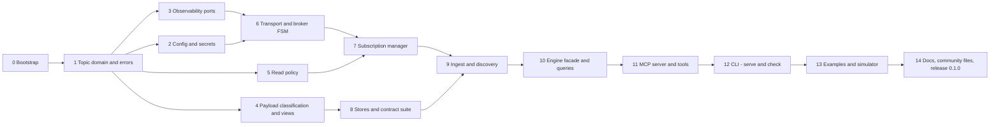

# 05 — V0.1 implementation plan

> Status: **Approved on 2026-09-18.** Decisions are recorded in the [ADRs](../adr/README.md), which prevail over this document where they differ.

Each step is a small pull request that **compiles, passes lint and tests, and leaves the
repository releasable**. "Verify" lists what proves the step is done. Steps are ordered by
dependency; steps on the same line of the dependency graph can run in parallel.

---

### Step 0 — Repository bootstrap

- `git init`, npm workspaces (`packages/core`, `packages/mcp-server`), `tsconfig.base.json`
  (strict flags from ADR-0001), project references, ESLint flat config with
  `strictTypeChecked`, module-boundary zones and a `no-console` rule, Prettier,
  `.editorconfig`, `.gitattributes` (LF), `.nvmrc`, Vitest workspace.
- GitHub Actions: `ci.yml` (lint, typecheck, unit tests on Node 22/24, plus Node 26 as non-blocking; Ubuntu, Windows,
  macOS), CodeQL, Dependabot.
- LICENSE (Apache-2.0) and NOTICE per ADR-0017, minimal README stating "pre-release".
- **Verify:** `npm ci && npm run check` (lint + typecheck + test) green locally and in CI
  with one trivial test per package.

### Step 1 — Topic domain, identifiers, errors, clock

- `domain/topic.ts`: parse/validate names and filters, `matches`, `covers`, `intersects`,
  `levels`; branded types.
- `domain/errors.ts`: error hierarchy and codes (ADR-0014); `sanitizeError`.
- `domain/clock.ts`: `Clock` port, `SystemClock`; `testing/FakeClock`.
- **Verify:** table-driven tests for every MQTT rule (including `$` topics, empty levels,
  `__proto__`, U+0000, 65,535-byte limit); fast-check properties
  (`covers(a,b) ∧ matches(b,t) ⇒ matches(a,t)`, etc.).

### Step 2 — Configuration and secrets

- zod schema (strict, unknown keys rejected), defaults, `SecretRef` resolution (`env`,
  `file`), `Secret` class, YAML loader, env-only quick start, relative path resolution,
  deep freeze, TLS file loading.
- **Verify:** valid/invalid fixtures with exact error paths; a secret never appears in
  `JSON.stringify`, `util.inspect`, template strings or error messages (tests).

### Step 3 — Observability ports

- `Logger` port, JSON stderr logger with redaction, `pretty` formatter, child loggers;
  `MetricsRecorder` port, no-op implementation, in-memory recorder for tests.
- **Verify:** redaction tests (URL userinfo, known secret keys, nested objects); nothing is
  ever written to stdout.

### Step 4 — Payload classification and safe views

- `classify(bytes, limits)`, `toView(payload, limits, redaction)`, JSON limiting walker,
  text escaping, binary hex preview + SHA-256 (`node:crypto`).
- **Verify:** corpus of malformed payloads (invalid UTF-8, BOM, NaN/Infinity literals,
  10 MB blobs, 1,000-level nesting, huge arrays, control characters, surrogate pairs); each
  classification documented by a test; views never exceed configured sizes.

### Step 5 — Read policy

- Rule compilation, `checkSubscribe(broker, filter)` (deny / allow / allow-with-filtering),
  `isReadable(broker, topic)`, per-broker merge (deny union).
- **Verify:** security test suite: deny precedence, overlap cases, `$SYS`, per-broker
  overrides, misconfiguration cases.

### Step 6 — Transport port, mqtt.js adapter, broker connection

- `MqttTransport` port; `testing/FakeTransport` (scriptable CONNACK/SUBACK/disconnects);
  `transport/mqttjs` adapter (options mapping, TLS Buffers, MQTT 5 properties,
  `maximumPacketSize`, hard connect timeout); `BrokerConnection` state machine with backoff
  and jitter; `BrokerRegistry`.
- **Verify:** unit tests of every FSM transition with `FakeTransport` + `FakeClock`;
  integration tests (Testcontainers Mosquitto): connect, TLS and mTLS, wrong password →
  `failed` without retries, broker restart → reconnect, `close()` during backoff.

### Step 7 — Subscription manager

- Leases, minimal covering set, one filter per SUBSCRIBE, SUBACK/UNSUBACK reason codes,
  reconciliation after reconnect, policy check before subscribing.
- **Verify:** unit tests of covering-set transitions; integration: Mosquitto ACL refusing
  `#` → lease `rejected` with reason code, others unaffected; resubscription after restart;
  overlapping leases produce one delivery each.

### Step 8 — Stores and contract suite

- `TopicCatalog` and `MessageStore` ports, mergeable statistics (`EwmaState`,
  `WelfordState`, merge functions), `MemoryTopicCatalog` (LRU, limits, tree aggregation,
  query with cursor), `MemoryMessageStore` (rings, byte budget).
- `testing/storeContract.ts`: the reusable contract suite.
- **Verify:** contract suite green on memory implementations; property test: merging deltas
  in any grouping yields identical records; eviction counters exact.

### Step 9 — Ingest pipeline and discovery

- Batch accumulator (O(1) hot path), flush scheduler, byte budgets, sampling, classification
  budget; `DiscoveryService` (lease per filter, coverage, gaps from broker state events,
  retained replay handling).
- **Verify:** unit tests with `FakeTransport` bursts; integration load test (100k messages /
  10k topics) asserting exact counts, bounded memory, counters when budgets are low;
  denied topics never reach stores.

### Step 10 — Engine facade and queries

- `createEngine`, `start`/`close`, `listBrokers`, `discover` (wait with signal + progress),
  `topicTree`, `searchTopics`, `describeTopic`, `recentMessages`; `Answer` envelope with
  limitation selection logic; broker resolution (`BROKER_AMBIGUOUS`).
- **Verify:** end-to-end library test against Mosquitto with a scripted publisher;
  snapshot tests of answers (with `FakeClock`); cancellation tests.

### Step 11 — MCP server and tools

- `createMcpServer(engine, options)`: six tools with zod v4 input/output schemas, text
  renderers, annotations, progress mapping, cancellation, error mapping, audit log.
- **Verify:** tests with the SDK client over an in-memory transport: `tools/list` snapshot
  (names, schemas, annotations: this is our public API), each tool's structured output
  validates, errors come back as `isError` with codes, cancellation stops
  `mqtt_discover_topics`.

### Step 12 — CLI

- `bin` entry: `serve` (default), `check`, `--config`, `--version`, `--help`; `serveStdio`;
  graceful shutdown (SIGINT, SIGTERM, stdin end); exit codes documented.
- **Verify:** spawn tests: `check` exit codes for valid/invalid config and unreachable
  broker; `serve` answers `tools/list` over real stdio and exits cleanly when stdin closes;
  stdout contains protocol frames only.

### Step 13 — Examples and simulator

- `examples/industrial-machine`: Docker Compose with Mosquitto and a TypeScript simulator
  (fictional `factory/line-01/...` namespace: PLC heartbeat/status, robot status/error/
  position, washer status, HMI alarm; JSON, text, numeric and one binary topic; retained
  state topics; a scripted "robot error 42" incident every N minutes).
- `examples/configs`, `examples/mcp-clients`, `.env.example`.
- **Verify:** CI job starts the compose stack and runs `check` plus a scripted MCP session
  asserting the expected topics are discovered.

### Step 14 — Documentation, community files, release

- README (what / why / capabilities / security model / quick start / example prompts /
  architecture / supported brokers / roadmap), `docs/*.md`, threat model in `security.md`,
  CONTRIBUTING (DCO), CODE_OF_CONDUCT, SECURITY.md, issue/PR templates, CODEOWNERS,
  Changesets, release workflow with npm provenance.
- **Verify:** a person unfamiliar with the project completes the quick start from the README
  alone in under five minutes; `0.1.0` published; release notes generated.

---

## Decisions taken before Step 0 (2026-09-18)

1. **Package names:** `@kadeya/mqtt-intel-core` and `@kadeya/mqtt-intel-mcp` (ADR-0002).
   Project name: MQTT Intelligence MCP. The npm scope is still to be confirmed.
2. **License:** Apache-2.0, NOTICE, DCO, no CLA. Copyright holder: Kadeya Inc. (Automated
   Water Machines, Inc.) (ADR-0017).
3. **Repository:** `github.com/kadeyaorg/mqtt-intelligence-mcp` (private for now).
4. **ADRs:** all accepted; Node.js support limited to LTS lines (ADR-0001, ADR-0016).
